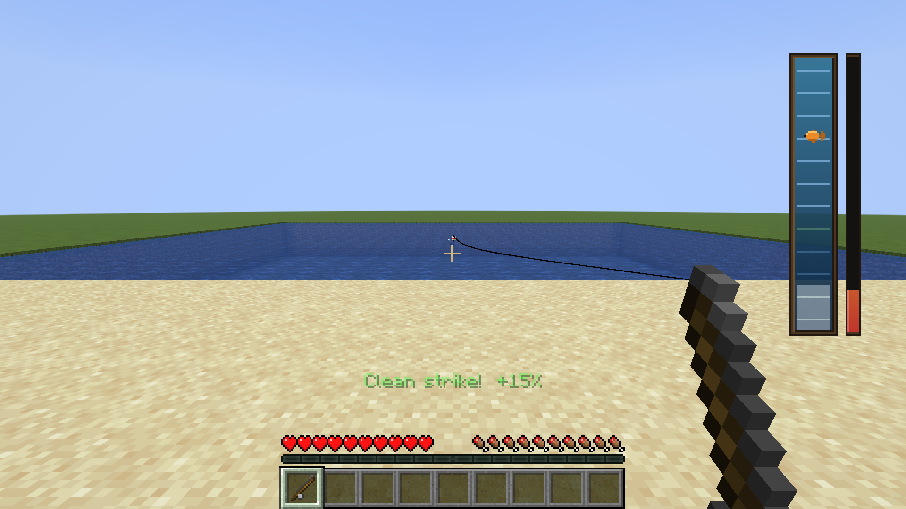

# Minedew Fishing

A Fabric mod that replaces the moment a fish bites your line with a Stardew Valley-inspired fishing minigame: set the hook, then fight the fish on a bar. Runs entirely server-side and renders through Pandorical.

## Screenshots

## How It Works

When a fish bites (detected from vanilla's own bite signal, not a heuristic), an encounter begins.

### 1. Set the hook

Exactly the way you already do it: the bobber splashes and goes under, so right-click.

There is no extra prompt for this and there is not meant to be. The window is open for as long as the bobber is under, because it *is* vanilla's own bite window, so "click while it is under" is the whole rule and it is one you already know. Click before the bite and you reel in an empty line; let the bite lapse and it is gone. There is a short grace period after the bobber pops back up, which is where the mod's network tolerance lives.

Being quick about it pays. A strike within about a third of a second of the bite is a **clean strike**: the catch meter opens 15% further along than usual, and the action bar says so. The bonus tapers to nothing for a strike just under a second after the bite; past that the hook is simply set.

### 2. Fight it on the bar

A water column appears with two things in it: a **marker**, swimming up and down on its own, and your **bobber**, a bar you keep under it.

The fight starts the moment the hook is set, but it cannot be lost in its first four seconds: for that long the catch meter will not fall below its usual starting point, which is the time to find the marker and settle into a rhythm. Anything above that, a clean strike's head start included, can still drain away.

The bobber is driven by **click impulses**. Every right-click gives it one kick upward; gravity pulls it down between clicks. Tap faster to rise, ease off to sink. It is deliberately not a held input: impulses are events that can arrive whenever the network delivers them, which is what makes a server-authoritative minigame playable at all.

Mashing does not help. At most one impulse is spent per tick, so past a workable cadence extra clicks do nothing except pin the bobber against the top of the track.

Beside the column is the **catch meter**. It fills while the marker is inside your bobber and drains while it is not. Fill it and the fish is yours. Empty it and it is gone.

### 3. Treasure, if you want it

Some fights surface a **treasure chest** partway in, at a fixed spot on the track, with its own meter that only fills while your bobber covers it.

That is the whole gamble: every moment you spend on the chest is a moment the catch meter is draining. And the chest only pays out if you land the fish too. Going for it is a real decision, not free loot.

## What's On The Line

Thirty-three fish, and junk. Which one bit is two questions.

Vanilla answers the first, the way it always has: the mod rolls Minecraft's own fishing loot table at the moment of the bite, so cod, salmon, pufferfish, tropical fish or junk come up at vanilla's odds, and Luck of the Sea, open-water treasure, biome-specific junk and any datapack edits all apply normally. That roll decides what lands on your plate: a cod roll is a lean fish and cuts into whitefish, a salmon roll an oily one.

The water answers the second. Of the fish that roll could be, which live where your bobber landed, at this hour, in this weather, at this depth? A cod roll in a cold river is a perch; in the same river after dark it might be a walleye; under rock, a blind cave fish. When nothing in particular lives there, it is the vanilla fish itself.

| Water | What lives there |
|---|---|
| Rivers | Smallmouth Bass, Perch, Walleye, Bream, Catfish, Pike, Sturgeon, Salmon, Rainbow Trout, Tiger Trout, Shad, Sunfish |
| Ponds and lakes | Largemouth Bass, Carp, Bullhead, Pike, Perch, Walleye, Rainbow Trout, Sunfish |
| Swamps | Largemouth Bass, Carp, Bullhead, Catfish, Eel |
| Mountain water | Chub |
| Jungle and warm fresh water | Tilapia, Dorado, Blue Discus |
| The sea | Cod, Lingcod, Sardine, Anchovy, Herring, Tuna, Albacore, Eel, Pufferfish, Blobfish, Stonefish, Lionfish, and the reef's tropical fish |
| Under rock | Blind Cave Fish, Stonefish |

Within those, the conditions narrow it further:

- **Temperature**: perch, lingcod, herring, tiger trout and sturgeon want cold or frozen water; tilapia, dorado, lionfish and the discus want warm. Minecraft has no seasons, so a winter fish elsewhere is a frozen-biome fish here
- **Time**: bream and blobfish come out at night, walleye in any low light, albacore at dawn and dusk, rainbow trout, sardines, tuna and dorado by day
- **Weather**: shad run in the rain, catfish and eels feed in it, rainbow trout and smallmouth bass want it clear
- **Depth**: the water under the bobber is measured. Pike, bullhead, largemouth bass and sunfish keep to the shallows; walleye, catfish and sturgeon to deep pools; lingcod, albacore, tuna and blobfish to deep sea, the deepest of it for the last two. Deep water, wherever it is, also pushes toward the bigger sizes

A tropical fish is one of vanilla's own: one of its twenty-two named fish (Clownfish, Queen Angelfish, Moorish Idol...), or else named for its pattern and colours, "Lime-Gray Snooper". Vanilla has always had those names, and only ever showed them on a bucket.

Each fish has a **fixed movement signature**, and the overlay tells you nothing for the whole fight - not the name, not the size. Fish move the way their family does - basses leap, carp cruise, pike and catfish sit still and strike, herrings flinch like one fish of a school, eels never stop flowing - and each has its own accent on top: a walleye hangs in the water now and then, a smallmouth bass makes a hard run. Learning to read them is the actual skill the mod is about. The name is the reward at the end. Every fish was tuned so that it fights as hard as cod and pufferfish do: the difference between them is character, not difficulty.

The size used to show as difficulty stars, and they had to go for the same reason: a grade handed down before the first click is a verdict, and one-star fights got abandoned instead of finished. A big one announces itself by thrashing anyway, which is a tell you earn rather than one you are given.

Difficulty comes from **size**, not species. Every fish comes in Small, Medium, Large and Trophy, and the bigger classes get a smaller bar, a longer fight, and a thrash that announces itself no matter what is on the line. Rain, deep water and night all push toward the bigger classes. A bigger fish also pays out more.

### Shown Off

A landed fish does not go straight in the bag. It comes in on the line and is held up in front of you for a moment, side-on and dangling, so you can see what you caught - a trophy pufferfish puffs up while it is there - and then it is yours.

### Fillets

Cod and salmon, raw and cooked, are reskinned as **fillets**. It is there so the size reward reads right: a trophy fish paying out five whole cod looks like five fish, while five fillets look like one big fish cut up, which is what actually happened. Vanilla clients see the ordinary items.

## Tips

- The hook set is the only timed moment, and it is vanilla's: watch the bobber, not the screen
- The first four seconds of a fight cannot lose it. Spend them finding the marker and a rhythm rather than chasing
- Tapping at a steady rate holds the bobber level. Learn where that rate is and everything else is a nudge away from it
- Leaving the rod alone will not land you a fish, and neither will an autoclicker. Both were measured
- Nothing is named or graded while you fight. Size shows in how hard it pulls, species in how it moves, and the name comes only when it is on the bank
- Where you cast is what you catch. To find a fish, change the water: a colder river, a deeper pool, the same pond after dark or in the rain

## The Fish In The World

The fish swimming in the world are the fish on the line. Each vanilla fish, the first time it loads, becomes whichever fish a bobber in that water would have caught, and looks it: a cod in a cold river is a perch, a salmon in a jungle river a dorado. It keeps that for good, and a bucket carries it. Every one wears the body of the vanilla fish it stands in for, so what it drops is unchanged: a walleye is a cod underneath, and cuts into whitefish.

Vanilla puts no fish at all in a pond or a swamp, so the mod adds some: cod to rivers, swamps, jungles and the ponds of forests, taiga and plains, salmon to swamps and jungles, and tropical fish to jungle water and temperate rivers, where they are sunfish and discus.

The new looks are drawn by Pandorical; a client without it sees the vanilla fish.

## Angler's Log

A tab of advancements for catching them all. One for each family, naming its fish and where to look for them, one each for the pike, the sturgeon, the eel and the blobfish, and two challenges: **Every Fish in the Sea**, for landing one of each of the thirty-three, and **Reef Survey**, for all twenty-two of the reef's named tropical fish.

## Getting Better, And Getting Paid

**A bad run gets kinder.** Every fish that gets away makes the next one a little easier to land: the bar is a little taller, and the odds tilt a little toward a smaller fish. It keeps going for five losses in a row, by which point the bar is two-fifths taller than it started and a trophy is rare, and then it stops getting easier. Landing a fish clears it all at once. Junk counts for nothing either way, in either direction: a boot lost is a snag, not a fight. The run is kept with the world, so logging off in disgust and coming back tomorrow finds the fish still feeling generous.

**Experience, by the fish.** A fish that got away still pays a little, one to three points by how hard it was. A fish landed pays by its size, and steeply: a small is a few points, a medium double that, a large double again, and a trophy is worth a night of smalls. A chest secured on the way in adds a little on top. Junk pays vanilla's floor for the effort of reeling.

**Two advancements**, under vanilla's Fishy Business: The Big One for landing a large fish or bigger, and Trophy Catch for landing a trophy. The rest are in the Angler's Log.

## Fishing Difficulty

On top of the size of the fish there are four difficulties: **Easiest**, **Easy**, **Normal** (the default) and **Hard**. The easier ones give a taller bar, a slower, calmer fish and a meter that drains slower; Hard gives a shorter bar and a quicker, jumpier fish, and leaves the meter as it is. Easiest is easy enough that a bar left parked mid-track lands some of the smaller fish, which for someone just learning is the point. A player's difficulty is fixed when the fish bites, so a change applies from the next one.

The server's difficulty is `difficulty` in `config/minedew-fishing.properties` (`easiest`, `easy`, `normal` or `hard`; default `normal`). Ops can also change it on the Minedew Fishing page of Pandorical's mods menu, which writes it back to the file. An op can set one player's over it:

- `/fishing difficulty` - anyone: says the server's difficulty, and yours if an op set one for you. Ops also see every online player who has their own
- `/fishing difficulty server <level>` - ops: sets the server's difficulty
- `/fishing difficulty player <players> <level>` - ops: sets it for those players, over the server's. It stays with the player across restarts and deaths
- `/fishing difficulty player <players> server` - ops: hands those players back to the server's

## Village Quests

With Village Quests installed, a fisherman can teach the minigame as a seven-lesson craft. Bring a cod, a salmon, a pufferfish and a tropical fish, and each lesson hands back how that catch moves on the bar. Then two live fish in a bucket: one of fresh water's own, for the lesson on how the water decides which fish bites, and a herring or one of its kin, for the one on how families move alike. Last, a nautilus shell. Finishing it earns a fishing rod.

## Other Things On The Line

Another mod can put something on the line that vanilla's fishing table never would. [Cobble Jaws](https://github.com/fatlard1993/cobble-jaws) does: in the ocean, now and then, the bite is a shark. Whatever it is fights by the same rules as a fish, with its own movement on the bar and its size rolled the same way, and it is only named once it is landed. A small shark is cut into whitefish like a cod. A big one is not landed at all: it comes up out of the water alive and **Surfaced** in red is the only warning you get.

## Pandorical

Minedew Fishing is server-authoritative and entirely server-side. The whole state machine (hook-set timing, fish motion, bobber physics, meter, treasure, outcome) runs on the server, and no minedew-fishing jar is ever needed on a client:

- The player's click is the ordinary rod right-click, which the server already receives as a vanilla use packet. The mod observes it server-side during an encounter and cancels vanilla reeling. There is no custom packet and no client-reported timing.
- The fight renders as a **Pandorical HUD overlay** driven entirely by declarative updates pushed from the server, including Pandorical's `particle_burst` component for the chest's capture ring, which the client animates itself off a phase clock rather than being fed per-tick. The hook set renders nothing at all: vanilla's own splash and dipped bobber are the prompt.

**Pandorical is required on the server, and on the client for the minigame.** Vanilla clients can join: if a connecting player doesn't have Pandorical, this mod leaves their fishing hook alone entirely and vanilla's normal fishing behavior applies unmodified for that player. There is no fallback minigame or reduced-feature mode.

## Development

Installing is in [DEVELOPMENT.md](DEVELOPMENT.md).

## License

MIT, see [LICENSE](LICENSE).

## Credits

- Inspired by [Stardew Valley](https://www.stardewvalley.net/) by ConcernedApe
- Built with [Fabric](https://fabricmc.net/)
- Created by justfatlard
